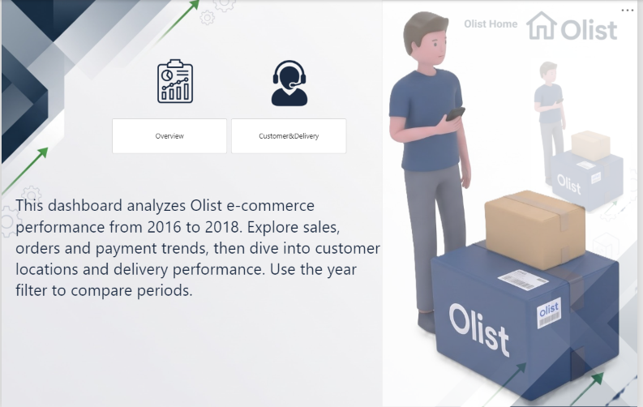
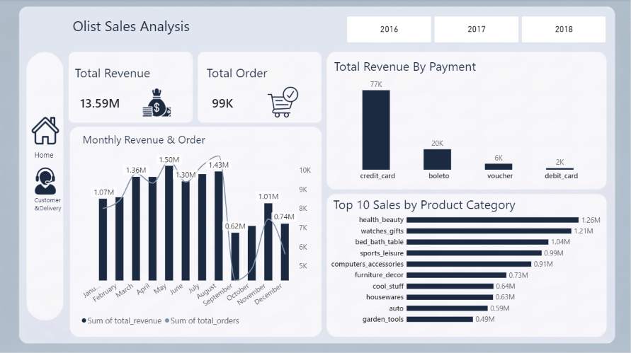
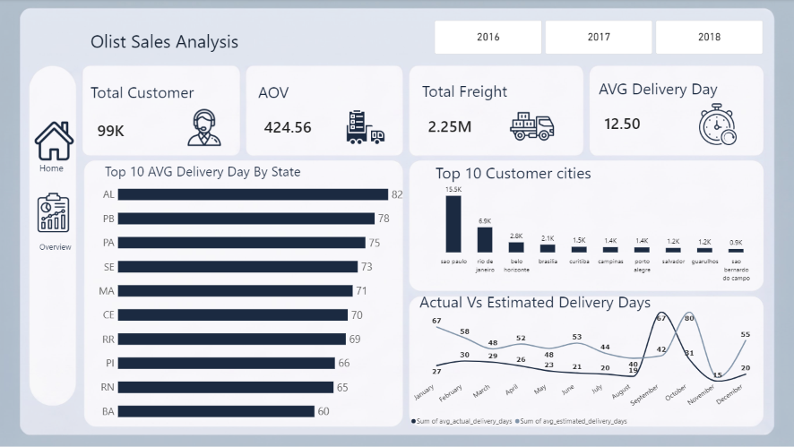

# Olist E-commerce Analysis

An analysis of the Olist Brazilian e-commerce dataset using Python, SQL Server and Power BI. The repository holds the raw data, a cleaning notebook, a SQL script with reporting views, and a Power BI dashboard file.

> **Note on reproducibility:** the pieces below were built by the author and are published as they are. The run instructions in this README were written from reading the code and have **not been tested end to end**. The repository does not include a script that loads the cleaned data into SQL Server, and it does not document which data source the Power BI file uses. See "Known gaps".

## Tools

- Python with pandas and NumPy (Jupyter notebook)
- SQL Server (T-SQL)
- Power BI

## Repository structure

| Folder | Contents |
| --- | --- |
| `olist_data_set/` | The 9 original Olist CSV files |
| `python/olist.ipynb` | Data cleaning notebook |
| `SQL/script.sql` | SQL Server script (UTF-16 encoded): creates the `core`, `rpt` and `stg` schemas and 17 views |
| `power bi/final_projectt.pbix` | Power BI dashboard file |
| `dashboard/` | Dashboard screenshots (Home, Overview, Customer & Delivery pages) |
| `releation/` | Data model screenshots (`schema.png`, `view_releation.png`) |
| `background&/` | Background images |

The full SQL Server database backup (`Olist_Brazil_Ecommerce.bak`, about 858 MB) is not in the repository because of GitHub's file size limit. It is attached to the [database-backup release](https://github.com/Moh7amed746/olist-ecommerce-analysis/releases/tag/database-backup).

## Data cleaning (`python/olist.ipynb`)

The notebook reads the 9 CSV files from a folder named `data` and:

- Drops geolocation rows outside Brazil's latitude/longitude range and removes exact duplicates
- Standardizes city names in geolocation, sellers and customers (lowercase, accents removed, extra spaces trimmed, "saopaulo" changed to "sao paulo")
- Renames the misspelled product columns `product_name_lenght` and `product_description_lenght`
- Treats zero product weight and size values as missing
- Adds two missing category translations (`pc_gamer`, `portateis_cozinha_e_preparadores_de_alimentos`)
- Keeps orders, reviews, payments and order items without deleting rows
- Writes cleaned files named `olist_<table>_clean.csv` plus `data_quality_report.csv` to a folder named `cleaned_data`

Requirements (from the imports): Python, pandas, NumPy and Jupyter. The final cell uses `display()`, which works in Jupyter. `Path`, `os` and `difflib` are part of the Python standard library.

## SQL views (`SQL/script.sql`)

Views, all built on `stg.*` tables:

- Delivery: `vw_Delivery_Analysis`, `vw_Delivery_Monthly`, `vw_On_Time_Delivery`, `vw_Late_Orders_Monthly`, `vw_Avg_Delivery_Time_By_State`
- Sales and orders: `vw_Sales_Monthly`, `vw_Sales_Category_Year`, `vw_Orders_Monthly`, `vw_Order_Items_Analysis`, `vw_Top10_Sales_By_Category`
- Customers, sellers, payments, reviews: `vw_Top10_Customer_Cities`, `vw_Top5_Cities_By_Sellers`, `vw_Payments_Analysis`, `vw_Revenue_By_Payment_Type`, `vw_Reviews_Analysis`
- Summary: `vw_Yearly_Dashboard_KPIs`

## How to run (untested)

1. Clone or download this repository.
2. **Cleaning (untested):** copy the CSVs from `olist_data_set/` into a folder named `data` next to the notebook, then run `python/olist.ipynb`. Output goes to `cleaned_data/`.
3. **Database (untested):** download `Olist_Brazil_Ecommerce.bak` from the release and restore it in SQL Server. The views in `SQL/script.sql` read from `stg.*` tables, which the restored database is expected to contain. Running the script against a different database requires those tables to exist first.
4. **Dashboard (untested):** open `power bi/final_projectt.pbix` in Power BI Desktop. You may need to change its data source to point to your own SQL Server instance.

## Known gaps

- No script or notebook step loads the cleaned CSVs into the `stg` tables in SQL Server. The link between the notebook output and the SQL script is not documented.
- It is not documented which data source the Power BI file uses (the database, the views, or the CSVs).
- The run steps above have not been tested.

## Dashboard preview

## Data source

Olist Brazilian E-commerce public dataset. No license or original download link is included in this repository.
